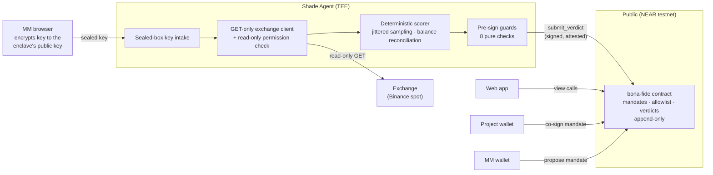

# Architecture

Three parts, one rule: **the only component that ever sees private data holds
no authority, and the only component with authority (the contract) sees no
private data.**

- **`contract/`** (Rust, near-sdk) — the public record. Mandates, the project
  allowlist, agent registration gated on attestation, and an append-only
  verdict log. It never sees a key, a quote, or a balance.
- **`agent/`** (TypeScript, Shade Agent) — the sealed inspector. It alone holds
  the MM's read-only exchange key, samples the account, scores it with plain
  code, and signs verdicts. It holds no funds and can move none.
- **`web/`** (Vite + React) — a thin client. It reads the contract directly
  over RPC and seals keys in the browser; it has no backend of its own.

## The flow



The enclave's X25519 public key is published on-chain (`set_enc_pubkey`) by the
registered agent, so the browser seals the exchange key to a key that exists
only inside the enclave. A key that can trade, transfer, or withdraw is
rejected at intake, before it is ever stored (`TRADE_ENABLED`).

## The life of one epoch

```mermaid
sequenceDiagram
  participant A as Agent (enclave)
  participant E as Exchange
  participant C as Contract

  Note over A: epoch opens — sample times drawn\nfrom a TEE-keyed jitter schedule,\nunpredictable to the MM
  loop one sample per window
    A->>E: GET book / orders / balances (read-only)
  end
  Note over A: epoch closes — deterministic scoring:\nspread · depth · uptime · net sells\n· withdrawals · balance reconciliation
  A->>C: view: mandate still Active? terms_hash? verdict exists? code approved?
  Note over A: 8 pre-sign guards — any violation,\nnothing is signed
  A->>C: submit_verdict (signed by registered agent)
  C->>C: verify caller is a registered, unexpired,\napproved-measurement agent; append verdict
  Note over C: if no verdict arrives before\nepoch_end + grace, anyone may\nrecord Missed — silence is visible
```

Two properties carry the design:

1. **Authority is on-chain, not in the agent.** `submit_verdict` checks the
   caller is a registered agent whose attestation is unexpired and whose
   measurements are approved, that the terms hash matches, the epoch is in
   range, and the metrics are in bounds. Swapping the agent's code breaks the
   measurement and the contract refuses the verdict.
2. **The record cannot be quietly edited.** Verdicts are append-only; there is
   no update or delete path. A scoring failure cannot be hidden by not
   submitting, because a missed epoch is itself recordable by anyone.

## File map

| Path | What it is |
|---|---|
| `contract/src/lib.rs` | Contract root: init, agent registration (attestation-gated), enclave-key publication. |
| `contract/src/mandates.rs` | Mandate terms, validation, propose / co-sign / cancel, `terms_hash`. |
| `contract/src/verdicts.rs` | `submit_verdict` (agent-gated, append-only), `record_missed`. |
| `contract/src/owner.rs` | Owner surface: measurement/PPID approval, project allowlist. |
| `contract/src/views.rs` | Public views: mandates, verdicts, agents, MM summaries. |
| `agent/src/index.ts` | HTTP surface + bootstrap: register, publish enclave key, stable local identity, RPC retry. |
| `agent/src/keys/` | Enclave keypair derivation, sealed-box intake, in-memory key store (never serialized). |
| `agent/src/exchange/` | GET-only Binance client, permission model, read-only verification. |
| `agent/src/sampling.ts` | TEE-keyed jittered sample schedule (anti-flicker-quoting). |
| `agent/src/scoring/` | The deterministic scorer — the exact rules live in [`docs/SCORING.md`](./docs/SCORING.md). |
| `agent/src/guards/` | The 8 pre-sign guards; pure functions over gathered facts. |
| `agent/src/runner.ts` · `submit.ts` | Epoch orchestration and signed submission. |
| `agent/src/sources/` | Data sources: `live` (exchange) and `replay` (committed fixtures, labelled). |
| `web/src/` | Directory, MM profiles, mandate timelines, create/co-sign, in-browser key sealing. |
| `fixtures/replay/` | The honest / dumping / outage / key-revoked scenarios the demo scores. |
| `agent/scripts/` | `seed.ts` (demo seeding), `make-env.ts` (env from the Shade keyring), `capture-evidence.ts` (chain-state evidence), `demo-replay.ts` (offline re-execution). |

## Trust boundaries

| Boundary | What crosses it | What never crosses it |
|---|---|---|
| Browser → enclave | The exchange key, sealed to the enclave's public key. | The key in plaintext (it is encrypted before leaving the page). |
| Enclave → exchange | Read-only GET requests. | Orders, transfers, withdrawals — the client exposes no write method at all. |
| Enclave → chain | Signed verdict metrics and status. | Raw samples, balances, the order book — the book never leaves the enclave. |
| Chain → everyone | Mandates, verdicts, agent registry. | Nothing private is ever on-chain to leak. |

The attack analysis over these boundaries — what we defend, what we mitigate,
and what we only accept — is [`docs/THREAT-MODEL.md`](./docs/THREAT-MODEL.md).
