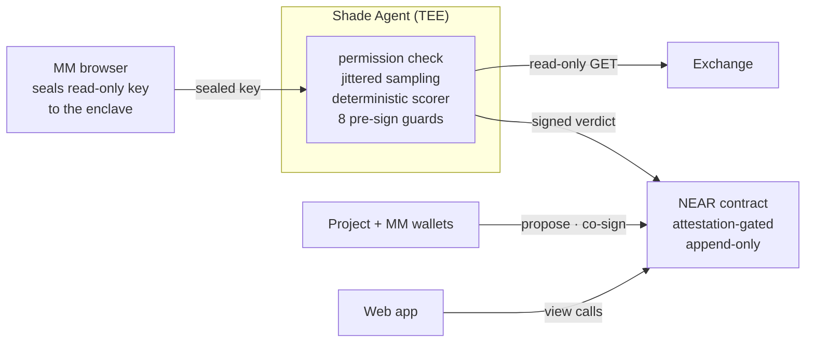

# Bona Fide

Market makers prove they kept their deals — inside a sealed enclave, so no one sees their book.

> The agent can't move money, so there's nothing to contain.

**Chain:** NEAR testnet · **Contract:** [`bona-fide-rt2.testnet`](https://testnet.nearblocks.io/address/bona-fide-rt2.testnet) · **Stack:** Shade Agents (NEAR × Phala dstack TEE) · **License:** Apache-2.0

**Built at** [NEAR HACKATHON](https://nearhackathon.com), entirely within the event window · **Tracks:** Privacy & Private AI (confidential computation in a TEE — the book never leaves the enclave) · AI Security & Defense (an agent given money to watch, and no keys to move it)

**It's not a mock.** The contract is deployed and seeded: mandate `0` (an honest
market maker) carries two on-chain **Pass** verdicts, and mandate `1` (a market
maker that dumped loaned tokens) carries an on-chain **Fail** — submitted by a
[registered agent](https://testnet.nearblocks.io/address/e3056536582c2c77e1ad9cb976cf5b4c95fe2dedd5ee95efec3e7237c7f2f8b4),
accepted by a contract that takes verdicts from no one else, recorded
append-only. Every claim in this paragraph regenerates from chain state with
one command, `npm run evidence`, and the captured, block-stamped responses are
committed in [`evidence/`](./evidence/). The hosted web app is live at
**[bona-fide-mm.vercel.app](https://bona-fide-mm.vercel.app)**.

---

## The problem

Token projects hire market makers to keep their markets liquid, and often lend
them tokens to do it. Two things go wrong, constantly: the market maker misses
the agreed KPIs — spread, depth, uptime — and the project cannot prove it; or
the market maker quietly sells the loaned tokens. The incumbent answer is a
grading service that requires the market maker to hand its order book to a
third party. Large firms tolerate that; small ones stay invisible or exposed.

In market making, the book *is* the strategy. Asking someone to publish it so
they can be trusted is asking them to stop being a market maker.

## What Bona Fide does — the life of one mandate

1. **Co-sign the terms on NEAR.** The market maker proposes an *Engagement
   Mandate* — token pair, exchange, KPI bounds, loan cap, dates. The terms are
   hashed, both parties see the hash, and the allowlisted project co-signs.
   From here the rules cannot drift: every verdict binds to that hash.
2. **Hand over a key that cannot spend.** The MM creates a **read-only**
   exchange key and pastes it into the app, where it is encrypted *in the
   browser* to a public key that exists only inside a TEE. Nobody — including
   us — sees it in transit.
3. **The enclave rejects dangerous keys on sight.** Before the key is ever
   used, the agent queries the exchange for the key's real permissions. Trade
   or withdrawal rights → rejected (`TRADE_ENABLED`), dropped, never stored.
4. **Sampling the MM can't predict.** Each epoch, the agent reads the account
   at pseudo-random moments derived from the enclave's key — reproducible for
   audit, unknowable in advance — so quoting only when watched doesn't work.
5. **Plain code decides.** A deterministic scorer computes spread, depth,
   uptime, net sells, withdrawals, and a balance reconciliation that catches
   tokens leaving by routes the trade log never shows (`BALANCE_LEAK`). Eight
   pre-sign guards then stand between the score and the signature.
6. **The record can't be quietly edited.** The contract accepts verdicts only
   from registered agents running approved, attested code; verdicts are
   append-only; and if an epoch's verdict never arrives, *anyone* may record
   the miss. Silence is visible.

> **AI may propose; deterministic code decides; the log can't be quietly edited.**

## Why "read-only" is the whole security story

Most agentic-finance security is about safely letting an agent *spend*. Bona
Fide's agent never spends — it only reads and signs attestations — so the
entire fund-movement attack surface is gone, not guarded:

- **Isolation** — no root wallet enters the agent; its only credential is a
  read-only exchange key sealed to the enclave.
- **Whitelisting at the protocol level** — the exchange client exposes **only
  GET**; there is no order or withdrawal code to trick into running.
- **Deterministic guards** — nothing is signed unless the mandate matches, the
  epoch has closed, the metrics are in range, the data source is recorded, and
  the agent's code is still approved.
- **Attestation** — the contract refuses verdicts from code whose measurements
  the owner hasn't approved, so the guards can't be bypassed by swapping code.

Even a fully compromised enclave is a *privacy* incident, never a theft: the
key it holds cannot move funds. The full attack-by-attack analysis — defended,
mitigated, and honestly accepted — is in
[`docs/THREAT-MODEL.md`](./docs/THREAT-MODEL.md).

## How it works



Component detail, sequence diagrams, and a file-by-file map:
[`ARCHITECTURE.md`](./ARCHITECTURE.md).

## What is real in this deployment, and what is simulated

Stated plainly, because it matters:

| Thing | Status |
|---|---|
| Contract, mandates, co-signing, verdicts, missed-epoch recording | **Real, live on testnet** — [`bona-fide-rt2.testnet`](https://testnet.nearblocks.io/address/bona-fide-rt2.testnet), recomputable via `npm run evidence` |
| Verdict submission gated to a registered agent | **Real** — the seeded verdicts were accepted only after registration + whitelist; unregistered callers are refused |
| Deterministic scorer, jitter, balance reconciliation, guards | **Real code** — 88 agent tests + 18 contract tests in CI, property-based, mutation-checked, cross-checked against an independent implementation |
| Market data behind the seeded verdicts | **Simulated** — committed replay fixtures, labelled with an amber **SIMULATED DATA** badge in the app; scoring of them is re-executable by anyone (`npm run demo:replay`) |
| Read-only key check | **Real logic**; demonstrated against canned Binance responses (labelled), since the live check needs a real exchange key |
| TEE attestation | **Real, live on testnet** — a second deployment, [`bona-fide-tee1.testnet`](https://testnet.nearblocks.io/address/bona-fide-tee1.testnet), runs `requires_tee: true` on Phala Cloud (Intel TDX, dstack 0.5.12). Its contract verified a genuine hardware quote and registered the enclave agent — non-zero measurements, real platform id, enclave key published — captured block-stamped in [`evidence/live-tee/`](./evidence/live-tee/). The demo mandates above remain on the local-attestation deployment, labelled as such |

## How to judge this fastest

**1. See the record (no wallet, nothing to install).** Open
[the app](https://bona-fide-mm.vercel.app), click a
market maker on the **Directory**, open a mandate, and read the epoch timeline
— green **Pass**, red **Fail** (with reasons like `LOAN_CAP`), grey **Outage**,
hatched **Missed**.

**2. Try to break it.** Open **Try the key check** and feed it the
trade-enabled key: the enclave's permission check rejects it on sight
(`TRADE_ENABLED`). The read-only key is accepted.

**3. Recompute a verdict yourself, offline.**
```bash
git clone https://github.com/ronniethedevv/bona-fide && cd bona-fide
npm --prefix agent install
npm run demo:replay
```
The real scorer runs on the committed fixtures and prints the same verdicts the
chain holds: honest → **Pass**, dumping → **Fail** (`LOAN_CAP`). No wallet, no
exchange account, no network.

**4. Recompute the evidence from chain state.**
```bash
npm --prefix agent install && npm run evidence
```
Every file in `evidence/live/` is rewritten from the live contract, each
stamped with the block it was read at. Diff it against what is committed.

**5. Run the whole stack.** Deploy your own copy for faucet NEAR —
[`DEPLOY.md`](./DEPLOY.md) is the complete path, WSL keyring quirks included.

## Components

| Part | What it is |
|---|---|
| [`contract/`](./contract/) | Rust (near-sdk), extends the Shade Agent template: mandates, project allowlist, attestation-gated agent registry, append-only verdicts, `record_missed`. |
| [`agent/`](./agent/) | TypeScript Shade Agent: enclave keypair, sealed-box key intake, GET-only exchange client, read-only permission check, jittered sampling, deterministic scorer, pre-sign guards, signed submission. |
| [`web/`](./web/) | Vite + React, no backend: directory, MM profiles, mandate timelines, create/co-sign, in-browser key sealing. |
| [`fixtures/replay/`](./fixtures/replay/) | The honest / dumping / outage / key-revoked scenarios the demo scores. |

**NEAR technology used:** Shade Agents (attested off-chain compute whose output
the contract verifies), a near-sdk contract as the registry and append-only
record, and wallet-selector for in-browser signing.

## Scoring, and how we know it is right

The exact rules — every definition, boundary, and rounding decision — are
specified in [`docs/SCORING.md`](./docs/SCORING.md), which also publishes what
a verdict proves *and what it does not*, plus the known adversarial findings as
a v2 backlog. Determinism is asserted as a property, not assumed: fast-check
property tests over adversarial inputs, an independently written reference
implementation compared case-by-case, and mutation checks that prove the suite
fails when the scorer is deliberately broken. The metrics mirror how real
market-maker obligations are written (two-sided quotes within X bps, minimum
size per side, present Y% of the time).

## Trust limits (read these)

- **Hardware trust:** if the TEE is broken, the book could leak. Keys are
  **read-only**, so funds can't move regardless.
- **Attestation, not re-execution.** Replay verdicts are publicly re-computable
  (`npm run demo:replay`). *Live* verdicts are deterministic but computed over
  samples only the enclave saw — publishing the raw data would leak the book,
  which is the point of the product. You verify a live verdict by checking that
  **approved, attested code** produced it, not by recomputing it yourself.
- **The exchange is a trusted oracle.** We attest our computation over what the
  exchange reported; we cannot prove the exchange reported truthfully.
- **One key shows one account.** The record proves what happened in the
  committed account. Balance reconciliation catches value leaving it by
  unreported routes (internal transfers), but it cannot prove the MM has no
  other accounts.
- **The project allowlist is owner-controlled** in this phase.

## Exchange

v1 uses **Binance** spot, read-only. Binance exposes a key's own permissions
via `GET /sapi/v1/account/apiRestrictions` — itself a read-only call — so the
enclave can reject a trade- or withdraw-enabled key before first use. That
endpoint is what makes "reject a dangerous key on sight" enforceable rather
than aspirational.

## Roadmap

- **Identity binding** — NEAR identity ↔ exchange account, privacy-preserving
  (salted enclave-held fingerprints; Sybil-resistant). Not a slide: built,
  tested, and merged ([PR #18](https://github.com/ronniethedevv/bona-fide/pull/18),
  [`docs/identity-binding.md`](./docs/identity-binding.md)); activates with the
  next contract deployment — the live v1 contract predates it.
- NEAR AI Cloud explainer for failed epochs (a private note from the metrics).
- Paid detailed lookups (HTTP 402).
- Chain Signatures mirror of summaries to other chains.
- A Midnight / zero-knowledge variant.

## Documentation

| Document | What's in it |
|---|---|
| [`ARCHITECTURE.md`](./ARCHITECTURE.md) | The three parts, the epoch sequence, trust boundaries, file-by-file map. |
| [`docs/THREAT-MODEL.md`](./docs/THREAT-MODEL.md) | 22 attacks: defence, enforcement point, honest status for each. |
| [`docs/SCORING.md`](./docs/SCORING.md) | The scoring specification, assurance method, industry references, published gaps. |
| [`evidence/`](./evidence/) | Deployment record + block-stamped chain state behind every claim. |
| [`DEPLOY.md`](./DEPLOY.md) | Reproduce the deployment end to end on testnet. |
| [`docs/demo-script.md`](./docs/demo-script.md) · [`SUBMISSION_CHECKLIST.md`](./SUBMISSION_CHECKLIST.md) | The demo video script and the submission checklist. |

## Develop

```bash
bash scripts/dev-setup.sh              # Rust wasm target + Node deps
cd contract && cargo test              # 18 tests
cd agent && npm ci && npm test         # 88 tests
cd web && npm ci && npm run build
```

CI runs rustfmt, clippy (`-D warnings`), both test suites, the web build, and a
guard that no AI context file is ever tracked — on every push and PR.

## Originality and license

Built for this hackathon on the
[Shade Agent template](https://github.com/NearDeFi/shade-agent-template)
(Apache-2.0), which provides the agent↔contract attestation plumbing; the
mandate registry, verdict record, scorer, guards, key intake, exchange layer,
and web app were written for this project. License:
[Apache-2.0](./LICENSE).
